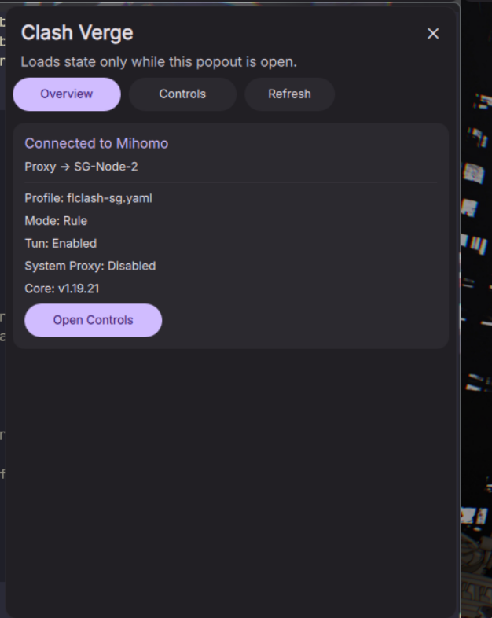

# Clash Verge Plugin for DankMaterialShell

A lightweight Clash Verge integration plugin for DankMaterialShell.

It adds a custom popout that reads live Mihomo state from the same Clash Verge runtime you already use, without polling in the background while the popout is closed.

## Features

- Live overview of the active Clash Verge profile and selector state
- Switch selector nodes from the DMS popout
- Switch Clash Verge profiles on demand
- Run manual per-node delay tests
- Run `Test all` for a selector group
- Stay idle while the panel is closed

## Requirements

- DankMaterialShell
- Clash Verge Rev running locally
- `python3` with `venv` support
- `node` for setups that use non-trivial Clash Verge profile scripts

## Installation

Clone this repository directly into your DMS plugins directory as `clashVerge`:

```bash
git clone https://github.com/smithyyang/dms-clash-verge-plugin.git ~/.config/DankMaterialShell/plugins/clashVerge
```

Or copy the files directly into:

```bash
~/.config/DankMaterialShell/plugins/clashVerge/
```

Required files:

- `plugin.json`
- `ClashVerge.qml`
- `scripts/run-helper.sh`
- `scripts/clash_verge_helper.py`
- `scripts/requirements.txt`

The helper bootstraps its own local virtual environment at first run inside `scripts/.venv/`.
The first open may take a little longer while that environment is created.

## Usage

- Click the Clash Verge widget in the DMS bar
- Use `Overview` to inspect current profile, mode, and runtime state
- Use `Controls` to switch selectors and profiles
- Use `Test` or `Test all` to run delay tests on demand

## Notes

- The plugin reads live state only when the popout is opened or when you explicitly trigger an action.
- Mode is intentionally display-only in the plugin to avoid drifting out of sync with Clash Verge's own UI state.
- Delay tests use Mihomo's built-in `/proxies/.../delay` API over Clash Verge's Unix socket.

## License

MIT

## Screenshot


